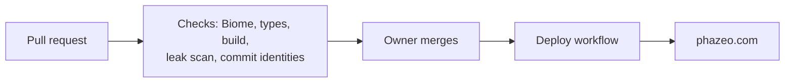

<p align="center">
  
</p>

# Phazeo

Landing site of a personal product studio: focused projects, experiments and ideas. Live at [phazeo.com](https://phazeo.com).

[](https://github.com/Phazeo/phazeo-com/actions/workflows/ci.yml)
[](https://scorecard.dev/viewer/?uri=github.com/Phazeo/phazeo-com)

## How a change ships



The deploy workflow is added with the move to the new repository; until then merging to `main` does not publish by itself.

## Quick start

Node 24 (see `.node-version`) and pnpm 11 (see `packageManager` in `package.json`).

```bash
pnpm install      # also installs the git hooks (husky), once per clone
pnpm dev          # http://localhost:4321
pnpm build        # static output in dist/
pnpm preview      # serve dist/
pnpm validate     # Biome + type check + build
node --test scripts/check-contributors.test.mjs
```

## Project structure

| Path                 | What is there                                                        |
| -------------------- | -------------------------------------------------------------------- |
| `src/pages/`         | The single page (`index.astro`)                                      |
| `src/components/`    | Layout, page sections and UI effects (Astro and React islands)       |
| `src/data/`          | Site metadata, copy and products                                     |
| `src/styles/`        | Tailwind and global styles                                           |
| `public/`            | Icons, logos, Open Graph image, `robots.txt`, `_headers`             |
| `logos/`             | Source logo files                                                    |
| `scripts/`           | Contributor check (commit identities) and its test                   |
| `tools/guard/`       | Leak guard: pinned secret scanner and its runner                     |
| `docs/`              | Design plans and the GitHub workflow                                 |

## Docs

[Docs index](./docs/README.md) · [GitHub workflow](./docs/GITHUB_WORKFLOW.md) · [Changelog](./CHANGELOG.md) · [Contributing](./CONTRIBUTING.md) · [Reporting a vulnerability](./SECURITY.md)

## Security notes

- Scripts and styles are covered by a Content Security Policy whose hashes Astro generates at build time (`security.csp` in `astro.config.mjs`); the other directives and headers are in `public/_headers`.
- Fonts are self-hosted; the page makes no third-party requests.
- Every commit and every pull request is scanned for secrets and network identifiers (`.gitleaks.toml`).

## License

All rights reserved. See [LICENSE](./LICENSE). Contributions: see [CONTRIBUTING.md](./CONTRIBUTING.md).
